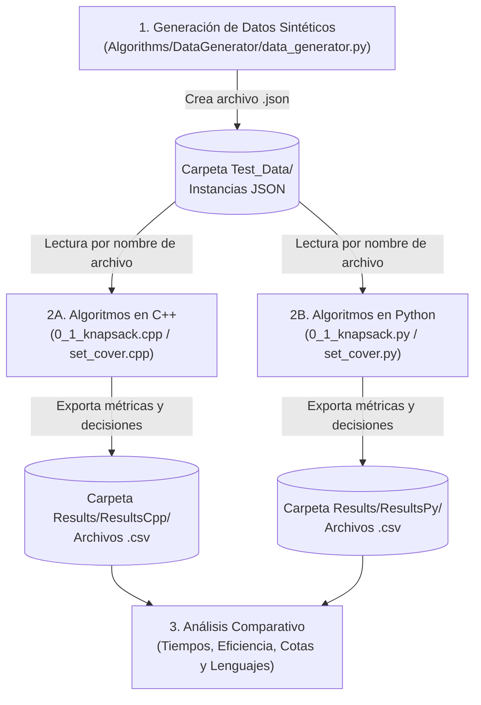

# Manual Técnico: Optimización de Aceleración de Etapas (Mochila 0/1) y Cobertura Mínima de Auditoría (Set Cover)

Este documento describe la arquitectura del proyecto, los requisitos de software, el flujo de trabajo completo (desde la generación de datos sintéticos hasta la exportación de resultados), el proceso detallado de compilación y ejecución, el diseño algorítmico a nivel de código y la comparativa técnica entre las implementaciones en **C++** y **Python**.

---

## 1. Estructura del Proyecto

El repositorio está organizado de forma modular separando el código fuente por lenguaje, los conjuntos de datos de entrada y los reportes generados:

```text
Proyecto_ADAG3/
├── Algorithms/
│   ├── AlgorithmsCpp/
│   │   ├── 0_1_knapsack.cpp       # Mochila 0/1 (Programación Dinámica) en C++
│   │   └── set_cover.cpp          # Cobertura de Conjuntos (Voraz) en C++
│   ├── AlgorithmsPy/
│   │   ├── 0_1_knapsack.py        # Mochila 0/1 (Programación Dinámica) en Python
│   │   └── set_cover.py           # Cobertura de Conjuntos (Voraz + Fuerza Bruta) en Python
│   └── DataGenerator/
│       └── data_generator.py      # Generador de instancias sintéticas en formato JSON
├── Test_Data/                     # Directorio de conjuntos de datos de entrada (.json)
│   ├── entrada_G3_mochila_20_nodos.json
│   └── test_data_YYYYMMDD_HHMMSS_ffffff.json
└── Results/                       # Directorio de salida generado automáticamente (.csv)
    ├── ResultsCpp/
    │   ├── Aceleracion/           # Resultados de 0_1_knapsack.cpp
    │   └── SetCover/              # Resultados de set_cover.cpp
    └── ResultsPy/
        ├── Aceleracion/           # Resultados de 0_1_knapsack.py
        └── SetCover/              # Resultados de set_cover.py
```

---

## 2. Requisitos Previos: ¿Qué se debe descargar e instalar?

Una característica de diseño clave de este proyecto es que **no requiere librerías externas de terceros** en ninguno de los dos lenguajes (ni gestores de paquetes como `vcpkg`/`conan` en C++, ni paquetes de `pip` en Python). Todo funciona utilizando exclusivamente las bibliotecas estándar.

### 2.1. Para los algoritmos en C++ (`AlgorithmsCpp`)
Se requiere un compilador compatible con el estándar **C++17** o superior, dado que el código utiliza la biblioteca `<filesystem>` (`std::filesystem`) para la resolución de rutas y creación automática de directorios, `<chrono>` para medición de tiempos de alta precisión y `<windows.h>` para configurar la salida UTF-8 en consolas de Windows.

* **En Windows (Opción A - Recomendada: MinGW-w64 / GCC):**
  1. Descargar **MSYS2** desde [https://www.msys2.org/](https://www.msys2.org/) o una distribución directa de **WinLibs MinGW-w64** desde [https://winlibs.com/](https://winlibs.com/).
  2. Si se usa MSYS2, instalar la cadena de herramientas ejecutando en su terminal:
     ```bash
     pacman -S --needed base-devel mingw-w64-ucrt-x86_64-toolchain
     ```
  3. Agregar la ruta de los binarios (por ejemplo, `C:\msys64\ucrt64\bin` o `C:\mingw64\bin`) a la variable de entorno `PATH` del sistema.
  4. Verificar en PowerShell o CMD con:
     ```powershell
     g++ --version
     ```
* **En Windows (Opción B: Microsoft Visual C++ - MSVC):**
  1. Descargar **Build Tools para Visual Studio** desde la página oficial de Microsoft.
  2. Seleccionar la carga de trabajo **"Desarrollo para el escritorio con C++"** (*Desktop development with C++*).
  3. Ejecutar los comandos desde la **Consola de herramientas nativas de x64 para Visual Studio** (`cl.exe`).
* **En Linux / macOS:**
  * **Ubuntu/Debian:** `sudo apt update && sudo apt install build-essential`
  * **macOS:** `xcode-select --install`

### 2.2. Para los algoritmos en Python y el Generador de Datos (`AlgorithmsPy` y `DataGenerator`)
* **Intérprete de Python (Versión 3.8 o superior):**
  1. Descargar el instalador oficial desde [https://www.python.org/downloads/](https://www.python.org/downloads/).
  2. **Importante en Windows:** Durante la instalación, marcar la casilla **"Add python.exe to PATH"**.
  3. Verificar la instalación ejecutando en la terminal:
     ```powershell
     python --version
     ```
  4. **Dependencias:** Ninguna adicional. Los scripts emplean únicamente módulos integrados en la librería estándar (`json`, `csv`, `pathlib`, `datetime`, `time`, `random`, `math`, `itertools`, `sys`).

---

## 3. Flujo de Trabajo General (Pipeline de Ejecución)

El flujo operativo que debe seguirse para realizar pruebas y comparaciones experimentales consta de tres etapas secuenciales:



1. **Fase 1 — Producción del Dataset (`DataGenerator`):** Se genera un archivo `.json` con $N$ etapas (o se utiliza uno existente en `Test_Data/`). El archivo queda almacenado automáticamente en la carpeta `Test_Data/`.
2. **Fase 2 — Compilación y Ejecución de Algoritmos:** Se compilan los programas en C++ y se ejecutan tanto las versiones en C++ como en Python. Cada programa solicita por consola el nombre del archivo `.json` ubicado en `Test_Data/` (sin necesidad de escribir la ruta completa, solo el nombre del archivo).
3. **Fase 3 — Recolección de Resultados (`Results/`):** Cada ejecución muestra un resumen en consola y crea de forma automática los archivos `.csv` con marca de tiempo (*timestamp*) en su subcarpeta correspondiente dentro de `Results/ResultsCpp/` o `Results/ResultsPy/`.

---

## 4. Producción de Datos Sintéticos con `DataGenerator`

El módulo [`data_generator.py`](Algorithms/DataGenerator/data_generator.py) permite construir instancias de prueba sintéticas de cualquier escala (por ejemplo, $N = 1000, 2000, 3000$ etapas) manteniendo coherencia matemática y estructural para ambos problemas (Mochila 0/1 y Set Cover).

### 4.1. Cómo ejecutar el generador
Desde la raíz del proyecto (`Proyecto_ADAG3`), ejecutar en la terminal:

```powershell
python Algorithms/DataGenerator/data_generator.py
```

El programa solicitará dos parámetros interactivos:
1. **Cantidad de etapas a generar ($N$):** Número entero (si se presiona `ENTER` en blanco, toma `1000` por defecto).
2. **Nombre del archivo `.json`:** Nombre base opcional. El sistema le concatenará automáticamente la fecha y hora exacta (`YYYYMMDD_HHMMSS_ffffff`) y lo guardará en `Test_Data/`.

### 4.2. Lógica interna y parametrización de los datos sintéticos
La función [`generar_datos_prueba`](Algorithms/DataGenerator/data_generator.py#L7-L141) construye un único archivo JSON unificado bajo las siguientes reglas de modelado:

1. **Relación 80/100 para Categorías de Riesgo ($r$):**
   * El número total de categorías de riesgo se calcula como el **80% del total de etapas**:
     $$r = \max(1, \lfloor 0.80 \times N \rfloor)$$
   * Se generan identificadores formateados (`R01`, `R02`, ..., `Rr`), asignando a cada uno una categoría aleatoria entre 12 dominios de auditoría (`sesgo`, `privacidad`, `formato`, `seguridad`, `trazabilidad`, `equidad`, `coherencia`, `robustez`, `disponibilidad`, `cumplimiento`, `integridad`, `transparencia`) y un nivel de importancia entre `1` y `5`.
2. **Topología de Flujo Secuencial:**
   * Construye la lista `flujo` conectando secuencialmente cada etapa con la siguiente: $E_1 \to E_2 \to \dots \to E_N$.
3. **Atributos de Tiempo, Costo y Auditoría por Etapa:**
   Para cada etapa $E_i$ ($1 \le i \le N$) se generan valores acotados que garantizan instancias realistas:
   * `duracion_normal`: Entero aleatorio en $[15, 35]$.
   * `costo_aceleracion`: Entero aleatorio en $[5, 18]$.
   * `reduccion_tiempo_si_acelera`: Entero aleatorio en $[3, \max(3, \min(\text{duracion\_normal} - 5, \text{costo\_aceleracion} + 2))]$, evitando que una etapa acelerada reduzca su duración a cero o valores negativos.
   * `riesgos_cubiertos_auditoria_completa`: Subconjunto aleatorio de entre $2$ y $5$ riesgos tomados del universo de riesgos disponibles.
   * `variaciones_auditoria`: Define dos modalidades (`parcial`, que cubre la mitad de los riesgos de la etapa a menor costo, y `completa`, que cubre la totalidad de riesgos asignados a la etapa).
4. **Cálculo del Presupuesto de Aceleración ($B$):**
   * Se suma el `costo_aceleracion` de las $N$ etapas y se asigna como presupuesto máximo $B$ el **35%** (`porcentaje_presupuesto = 0.35`) de dicho costo total:
     $$B = \left\lfloor 0.35 \times \sum_{i=1}^{N} \text{costo\_aceleracion}_i \right\rfloor$$
   * Esto garantiza que el presupuesto sea restrictivo (no es posible acelerar todas las etapas) y obligue al algoritmo de programación dinámica a seleccionar la combinación óptima.

---

## 5. Compilación y Ejecución Paso a Paso

Todos los programas están diseñados para buscar automáticamente el archivo JSON indicado dentro de `Test_Data/` (incluso si el ejecutable se invoca desde la raíz del proyecto o desde su propia subcarpeta).

### 5.1. Compilación y Ejecución en C++

Se recomienda compilar utilizando la bandera `-std=c++17` (obligatoria para `<filesystem>`) y `-O3` (optimización máxima del compilador para comparaciones de tiempo de ejecución justas).

#### A. Algoritmo Mochila 0/1 (`0_1_knapsack.cpp`)
* **Compilar con MinGW-w64 (`g++`) desde la raíz del proyecto:**
  ```powershell
  g++ -std=c++17 -O3 Algorithms/AlgorithmsCpp/0_1_knapsack.cpp -o Algorithms/AlgorithmsCpp/0_1_knapsack.exe
  ```
* **Compilar con MSVC (`cl.exe`) (Alternativa en consola de Visual Studio):**
  ```powershell
  cl /std:c++17 /O2 /EHsc Algorithms\AlgorithmsCpp\0_1_knapsack.cpp /Fe:Algorithms\AlgorithmsCpp\0_1_knapsack.exe
  ```
* **Ejecutar:**
  ```powershell
  .\Algorithms\AlgorithmsCpp\0_1_knapsack.exe
  ```
  *Cuando el programa lo solicite en consola, ingresar únicamente el nombre del archivo (por ejemplo: `entrada_G3_mochila_20_nodos.json`).*

#### B. Algoritmo Cobertura de Conjuntos (`set_cover.cpp`)
* **Compilar con MinGW-w64 (`g++`) desde la raíz del proyecto:**
  ```powershell
  g++ -std=c++17 -O3 Algorithms/AlgorithmsCpp/set_cover.cpp -o Algorithms/AlgorithmsCpp/set_cover.exe
  ```
* **Compilar con MSVC (`cl.exe`) (Alternativa en consola de Visual Studio):**
  ```powershell
  cl /std:c++17 /O2 /EHsc Algorithms\AlgorithmsCpp\set_cover.cpp /Fe:Algorithms\AlgorithmsCpp\set_cover.exe
  ```
* **Ejecutar:**
  ```powershell
  .\Algorithms\AlgorithmsCpp\set_cover.exe
  ```
  *Ingresar el nombre del archivo JSON ubicado en `Test_Data` cuando se solicite.*

---

### 5.2. Ejecución en Python

Al ser un lenguaje interpretado, los scripts de Python no requieren paso previo de compilación manual. Desde la raíz del proyecto:

#### A. Algoritmo Mochila 0/1 (`0_1_knapsack.py`)
```powershell
python Algorithms/AlgorithmsPy/0_1_knapsack.py
```

#### B. Algoritmo Cobertura de Conjuntos (`set_cover.py`)
```powershell
python Algorithms/AlgorithmsPy/set_cover.py
```

En ambos casos, el script pedirá por entrada estándar el nombre del archivo JSON ubicado en `Test_Data/` (por ejemplo, `entrada_G3_mochila_20_nodos.json`).

---

## 6. Explicación de la Solución a Nivel de Código y Algorítmico

Aunque ambos problemas leen exactamente el mismo archivo `.json` de entrada ubicado en `Test_Data/`, cada algoritmo extrae únicamente las propiedades relevantes para su modelo matemático.

### 6.1. Estructura del Set de Datos Utilizado
Cada archivo en `Test_Data/` contiene cuatro bloques principales:
* `parametros`: Metadatos globales (`numero_etapas`, `presupuesto_aceleracion_B`, `presupuesto_conjunto_aceleracion_y_auditoria`, `numero_categorias_riesgo`).
* `flujo`: Lista de aristas dirigidas que definen el orden cronológico de las etapas ($E_1 \to E_2 \to \dots \to E_N$).
* `categorias_riesgo`: Lista del universo de riesgos $U = \{R_1, R_2, \dots, R_r\}$ que deben ser auditados.
* `etapas`: Arreglo de objetos con los datos de duración, costos de aceleración, reducción de tiempo y riesgos cubiertos por cada etapa.

---

### 6.2. Problema 1: Optimización de Aceleración de Etapas (`0_1_knapsack`)

* **Archivos asociados:** [`0_1_knapsack.cpp`](Algorithms/AlgorithmsCpp/0_1_knapsack.cpp) y [`0_1_knapsack.py`](Algorithms/AlgorithmsPy/0_1_knapsack.py).
* **Subconjunto de datos que consume:** Lee el límite `presupuesto_aceleracion_B` ($B$) del bloque `parametros` y, por cada elemento en `etapas`, extrae `id`, `duracion_normal`, `costo_aceleracion` ($c_i$) y `reduccion_tiempo_si_acelera` ($r_i$).

#### Cómo se resuelve el problema a nivel general en el código:
El problema consiste en seleccionar qué etapas de un pipeline secuencial deben acelerarse (decisión binaria $x_i \in \{0, 1\}$) para **maximizar el tiempo total reducido** sin superar el presupuesto disponible $B$. La solución en código se estructura en **cuatro fases bien diferenciadas**:

1. **Fase de Ingesta y Preparación:**
   Se lee el archivo JSON y se transforma cada etapa en una estructura en memoria con su costo de aceleración y su beneficio (reducción de tiempo).
2. **Fase de Programación Dinámica (Tabulación *Bottom-Up*):**
   En [`optimizarAceleracionMochila`](Algorithms/AlgorithmsCpp/0_1_knapsack.cpp#L118-L205) (C++) y [`optimizar_aceleracion_mochila`](Algorithms/AlgorithmsPy/0_1_knapsack.py#L30-L116) (Python), se construye una tabla bidimensional `dp` de dimensiones $(n + 1) \times (B + 1)$ inicializada en `0`.
   * Se itera sobre cada etapa $i \in \{1, \dots, n\}$ y sobre cada nivel de presupuesto $w \in \{0, \dots, B\}$ aplicando la ecuación de recurrencia de Bellman:
     $$DP[i][w] = \begin{cases} \max\big(DP[i-1][w],\; DP[i-1][w - c_i] + r_i\big) & \text{si } c_i \le w \\ DP[i-1][w] & \text{si } c_i > w \end{cases}$$
   * **Aislamiento del cronometraje:** El temporizador de alta precisión envuelve exclusivamente la creación y llenado de la matriz `dp` (complejidad temporal y espacial $\mathcal{O}(n \cdot B)$), evitando contaminar la métrica con tiempos de lectura de disco o reconstrucción.
3. **Fase de Reconstrucción de Decisiones (*Backtracking*):**
   Una vez hallada la reducción máxima óptima en `dp[n][B]`, el algoritmo recorre las etapas en sentido inverso (desde $i = n$ hasta $1$) manteniendo un puntero al presupuesto restante $w$:
   * Si `dp[i][w] != dp[i - 1][w]`, significa que la etapa $i$ fue incluida en la solución óptima: se marca `decisiones[i - 1] = true` y se descuenta su costo ($w \leftarrow w - c_i$).
   * En caso contrario, la etapa no fue acelerada y $w$ permanece intacto.
4. **Fase de Simulación Cronológica Progresiva y Exportación:**
   Con el vector de decisiones ya determinado, el código recorre las etapas en orden cronológico real ($E_1 \to E_n$) simulando la ejecución del pipeline: calcula la duración final de cada etapa, el presupuesto disponible antes y después de cada nodo y las métricas agregadas (duración inicial total, reducción lograda, duración final, costo acumulado y eficiencia global $\text{reducción}/\text{costo}$). Finalmente, exporta dos archivos CSV en `Results/.../Aceleracion/`:
   * `resultados_aceleracion_N<n>_<timestamp>.csv`: Trazabilidad paso a paso de cada etapa.
   * `resumen_optimizacion_N<n>_<timestamp>.csv`: Métricas consolidadas y tiempo de ejecución de la programación dinámica.

---

### 6.3. Problema 2: Cobertura Mínima de Auditoría (`set_cover`)

* **Archivos asociados:** [`set_cover.cpp`](Algorithms/AlgorithmsCpp/set_cover.cpp) y [`set_cover.py`](Algorithms/AlgorithmsPy/set_cover.py).
* **Subconjunto de datos que consume:** Lee todos los identificadores de `categorias_riesgo` para conformar el universo requerido $U = \{R_1, \dots, R_r\}$, y de cada elemento en `etapas` extrae su `id` y la lista `riesgos_cubiertos_auditoria_completa` ($S_i \subseteq U$).

#### Cómo se resuelve el problema a nivel general en el código:
Dado que el Problema de Cobertura de Conjuntos (*Set Cover*) es **NP-Hard**, encontrar el subconjunto mínimo de etapas cuyas auditorías cubran el 100% de los riesgos requeridos mediante búsqueda exhaustiva es computacionalmente intratable para instancias grandes. La solución en código se divide en las siguientes etapas:

1. **Fase de Verificación de Factibilidad en $\mathcal{O}(n \cdot r)$:**
   Antes de ejecutar la optimización, las funciones [`verificarFactibilidad`](Algorithms/AlgorithmsCpp/set_cover.cpp#L96-L109) (C++) y [`verificar_factibilidad`](Algorithms/AlgorithmsPy/set_cover.py#L11-L22) (Python) calculan la unión de los riesgos cubiertos por todas las $n$ etapas ($\bigcup_{i=1}^{n} S_i$) y comprueban si contiene a todo el universo requerido $U$. Si algún riesgo no es cubierto por ninguna etapa, el programa reporta que la instancia es `INFACTIBLE` y aborta de forma controlada.
2. **Fase de Selección Voraz (*Greedy Set Cover*):**
   En [`ejecutarSetCoverVoraz`](Algorithms/AlgorithmsCpp/set_cover.cpp#L112-L144) (C++) y [`cobertura_voraz_set_cover`](Algorithms/AlgorithmsPy/set_cover.py#L25-L60) (Python), se mantiene un conjunto de riesgos `pendientes` inicialmente igual a $U$:
   * En cada iteración del bucle `while`, se evalúan todas las etapas candidatas y se calcula cuántos riesgos **nuevos** (aún presentes en `pendientes`) aporta cada etapa: $|S_i \cap \text{pendientes}|$.
   * Se selecciona de forma voraz la etapa que maximiza la cantidad de nuevos riesgos cubiertos, se registra el paso de selección y se eliminan dichos riesgos del conjunto `pendientes` ($\text{pendientes} \leftarrow \text{pendientes} \setminus S_{\text{mejor}}$).
   * El ciclo termina cuando `pendientes` queda vacío. Su complejidad temporal es $\mathcal{O}(n \cdot r \cdot \min(n, r))$.
3. **Fase de Verificación Teórica (Cotas Armónicas de Chvátal / Johnson) y Validación Empírica:**
   * Ambas implementaciones calculan la cardinalidad máxima cubierta por un solo nodo ($d_{\max} = \max_i |S_i|$) y obtienen las cotas armónicas teóricas del factor de aproximación:
     $$H(d_{\max}) = \sum_{k=1}^{d_{\max}} \frac{1}{k}, \qquad H(r) = \sum_{k=1}^{r} \frac{1}{k}$$
   * Adicionalmente, la versión de Python incluye la función [`cobertura_optima_fuerza_bruta`](Algorithms/AlgorithmsPy/set_cover.py#L63-L83), que se activa automáticamente cuando $n \le 25$: explora en orden creciente de tamaño $k = 1, \dots, n$ todas las combinaciones posibles $\binom{n}{k}$ hasta hallar el óptimo exacto $|\text{OPT}|$, permitiendo verificar empíricamente en consola que el ratio de aproximación cumple $\frac{|V|}{|\text{OPT}|} \le H(d_{\max})$.
4. **Fase de Persistencia en CSV:**
   Exporta en `Results/.../SetCover/resultados_setcover_N<n>_<timestamp>.csv` el orden exacto en que se eligieron las etapas, su identificador, la lista de riesgos nuevos cubiertos separados por punto y coma (`;`) y la cantidad aportada en cada paso.

---

## 7. Comparación entre las Implementaciones: C++ vs. Python

Más allá de que ambas implementaciones ejecutan la misma lógica algorítmica y las mismas complejidades asintóticas ($\mathcal{O}(n \cdot B)$ para Mochila 0/1 y $\mathcal{O}(n \cdot r \cdot \min(n, r))$ para Set Cover), existen diferencias profundas derivadas del diseño de cada lenguaje de programación:

### 7.1. Tabla Comparativa General

| Dimensión de Análisis | Implementación en C++ (`AlgorithmsCpp`) | Implementación en Python (`AlgorithmsPy`) |
| :--- | :--- | :--- |
| **Modelo de Ejecución** | Compilado *Ahead-of-Time* (AOT) directamente a código máquina nativo del procesador. | Interpretado sobre *bytecode* ejecutado por la máquina virtual CPython. |
| **Tipado y Estructuras** | Tipado estático fuerte con `struct` contiguos (`Etapa`, `Interaccion`, `PasoReconstruccion`). | Tipado dinámico basado en diccionarios (`dict`) y listas (`list`) de alto nivel. |
| **Representación de la Matriz DP (`0_1_knapsack`)** | `std::vector<std::vector<int>>`: cada fila es un bloque contiguo de enteros de 32 bits (`4 bytes` por celda), favoreciendo la localidad espacial en la caché L1/L2 del CPU. | Lista de listas `[[0] * (B + 1) ...]`: cada celda almacena una referencia (puntero de 8 bytes) hacia un objeto `PyLongObject` (28 bytes), incrementando el consumo de memoria y la indirección. |
| **Operaciones de Conjuntos (`set_cover`)** | Uso de `std::unordered_set<std::string>` e iteración explícita mediante bucles `for` anidados con `pendientes.count(r)` y vector booleano `usadas[i]`. | Uso del tipo nativo `set` con operadores algebraicos de conjuntos (`c["riesgos"] & pendientes` para intersección y `pendientes -= mejor_cobertura` para diferencia). |
| **Lectura y Parsing de JSON** | Analizador léxico propio sobre `std::string` ([`cargarDatosJSON`](Algorithms/AlgorithmsCpp/0_1_knapsack.cpp#L67-L115) y [`cargarJSONAuditoria`](Algorithms/AlgorithmsCpp/set_cover.cpp#L35-L93)) basado en búsqueda de tokens (`find`, `rfind`, `substr`) sin librerías externas. | Deserialización directa a estructuras nativas mediante el módulo estándar `json.load()`, delegando el parsing al motor en C de la librería estándar de Python. |
| **Alcance de Validación (`set_cover`)** | Enfoque exclusivo en el algoritmo voraz y cálculo de cotas armónicas $H(d)$ y $H(r)$ para máxima escalabilidad. | Incluye además búsqueda exacta por fuerza bruta ([`cobertura_optima_fuerza_bruta`](Algorithms/AlgorithmsPy/set_cover.py#L63-L83)) usando `itertools.combinations` cuando $n \le 25$. |
| **Instrumentación Temporal** | `std::chrono::high_resolution_clock` con resolución de nanosegundos. | `time.perf_counter()` con el reloj monotónico de mayor resolución disponible en el sistema operativo. |

### 7.2. Diferencias Clave a Nivel de Lenguaje y Comportamiento

1. **Sobrecarga de Bucles Anidados vs. Operaciones Nativas:**
   * En **Mochila 0/1**, el núcleo algorítmico consiste en un doble bucle `for` de $n \times B$ iteraciones con sumas y comparaciones enteras. En **C++**, el compilador con `-O3` desenrolla el bucle y mantiene las variables en registros del procesador (e incluso vectoriza con instrucciones SIMD). En **Python**, cada iteración del bucle interno ejecuta múltiples instrucciones de *bytecode* (búsqueda de índices en listas, despacho dinámico de tipos y llamada a `max()`), lo que hace que C++ sea entre **50 y 150 veces más rápido** al escalar a $N = 1000, 2000, 3000$ nodos.
   * En **Set Cover**, la brecha relativa es menor que en Mochila 0/1 porque en Python la operación crítica de intersección de conjuntos (`c["riesgos"] & pendientes`) se ejecuta internamente en código C precompilado dentro del intérprete CPython, reduciendo el costo del bucle interpretado.
2. **Orden de Iteración en Tablas Hash (`unordered_set` vs `set`):**
   * Al comparar los archivos CSV generados por [`set_cover.cpp`](Algorithms/AlgorithmsCpp/set_cover.cpp) y [`set_cover.py`](Algorithms/AlgorithmsPy/set_cover.py) sobre la misma entrada (por ejemplo, `entrada_G3_mochila_20_nodos.json`), se observa que **ambos seleccionan exactamente las mismas etapas en el mismo orden** (`E01`, `E16`, `E06`, `E03`) y con la misma cantidad de riesgos cubiertos (`4`, `4`, `3`, `1`), pero el orden en que se listan los riesgos dentro de la cadena separada por `;` puede diferir (ej. `"R10;R03;R02;R01"` en C++ frente a `"R01;R10;R03;R02"` en Python).
   * Esto ocurre porque `std::unordered_set` en C++ utiliza una función hash determinista dependiente de la implementación de la STL, mientras que `set` en Python aplica *hash randomization* por sesión (PEP 456) por motivos de seguridad, alterando el orden de recorrido interno de los elementos sin afectar el resultado matemático del conjunto.
3. **Mantenibilidad y Expresividad vs. Control de Bajo Nivel:**
   * **Python** permite expresar el algoritmo de Mochila 0/1 en 245 líneas y Set Cover (incluyendo fuerza bruta) en 207 líneas, con manejo nativo de JSON y CSV (`csv.DictWriter`).
   * **C++** requiere mayor verbosidad (385 líneas para Mochila 0/1 y 289 líneas para Set Cover) debido a la definición explícita de tipos (`struct`), el formateo manual de flujos (`std::ostringstream`, `std::ifstream`) y la extracción manual de campos JSON, a cambio de ofrecer control total sobre el uso de memoria y un tiempo de respuesta de microsegundos o pocos milisegundos incluso en instancias masivas.

